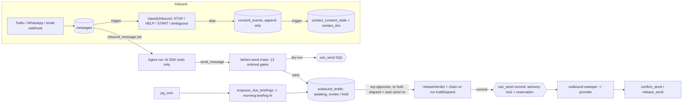
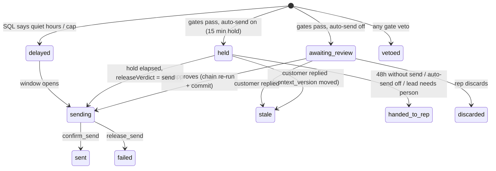
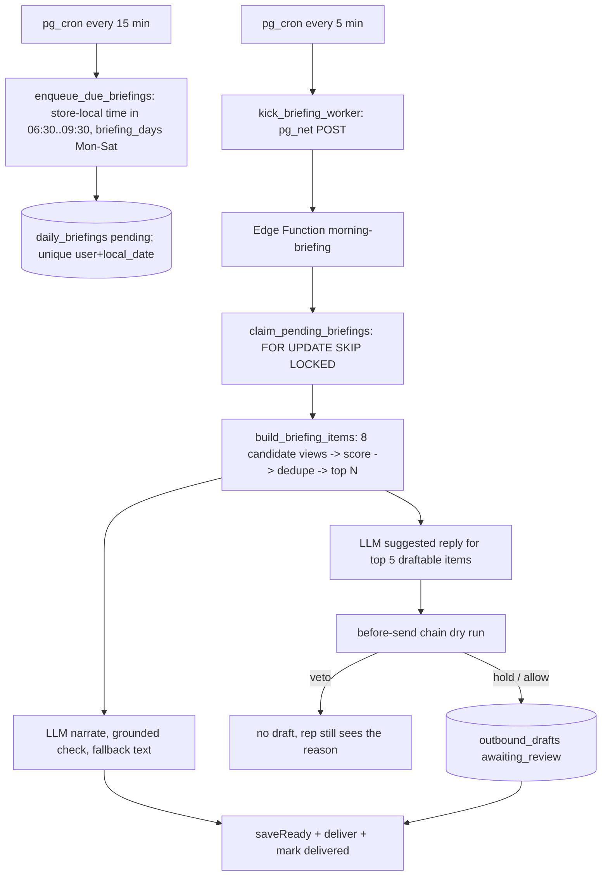
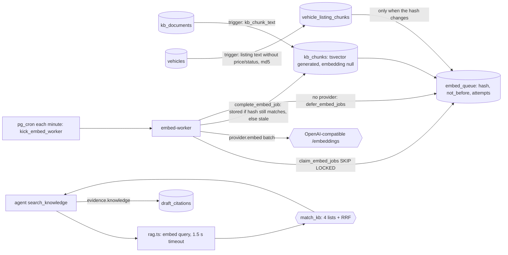
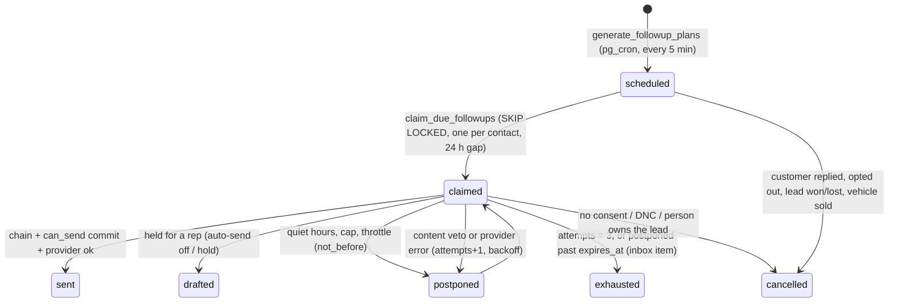
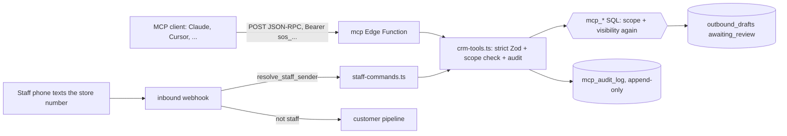

# SalesOS: Consent Ledger, Guardrailed Agent, Briefing, Knowledge (RAG), Follow-ups, Auto-Pipeline, CRM by Text + MCP, Runtime

Stack: Next.js + Supabase (Postgres, RLS, Edge Functions, pg_cron/pg_net) + Vercel AI SDK. Market: US automotive dealerships. Posture: **consent-first**. The default answer to "may we send this?" is no.

Contents: this file; migrations `supabase/migrations/20261126183200_consent_agent_briefing.sql` (phase 1) `20261126183300_rag_followups_classification_mcp.sql` (phase 3), `20261126183400_runtime_channels_webhooks_workers.sql` (phase 4) and `20261126183500_offline_gaps.sql` (phase 5), which are the source of truth for state; shared Edge code in `supabase/functions/_shared/` (`before-send`, `opt-out`, `gate-context`, `embeddings`, `rag`, `classify`, `crm-tools`, `staff-commands`); Edge Functions `morning-briefing`, `outbound-sweeper`, `embed-worker`, `mcp`; agent tools in `lib/agent/tools.ts`; tests in `tests/sql`, `tests/ts`, `tests/integration`.

> Not legal advice. Quiet-hours state rows, the AI-disclosure wording and the STOP/HELP copy are starting points to review with TCPA counsel before go-live.

## 1. Architecture in one picture

Three rules hold everything together:

1. **Postgres decides consent and pacing** (`can_send`). TypeScript decides content (gates). Neither trusts the model.
2. **The model has no send path.** Free text is discarded. Only the `send_message` tool reaches a customer, and it lands in a review queue unless the dealer has turned on auto-send.
3. **Every veto is a teaching error**, so the model can fix a draft in the same turn instead of failing silently.

## 2. Consent ledger and `can_send()`

* `consent_events` is append-only (trigger blocks UPDATE/DELETE). `contact_consent_state` and `contact_dnc` are derived by trigger, never written by apps.
* Purposes nest: `marketing` ⊃ `conversational` ⊃ `transactional`. A marketing grant covers the lower two.
* A grant only counts with **provenance**: a contact-initiated source (inbound text, web form the customer submitted), or a `proof_uri` in the evidence. Marketing grants also need `disclosure_text_version`. A rep ticking a box proves nothing.
* **Staff cannot clear a DNC.** Only a contact-initiated event (e.g. the customer texts START) clears a channel DNC; an all-channel DNC is not cleared by a grant.
* `can_send(dealer, contact, channel, purpose, kind, number, body, lead, actor, is_template, commit, idempotency_key, now)` returns `send_decision {verdict allow|delay|veto, code, reason, not_before, reservation_id, details}`.

```mermaid
stateDiagram-v2
  [*] --> unknown
  unknown --> granted: contact-initiated grant (or grant + proof_uri)
  granted --> revoked: STOP / opt-out phrase / any revoke event
  revoked --> granted: contact-initiated START only
  granted --> granted: wider purpose grant
  note right of revoked: contact_dnc row opened; staff cannot close it
```

### Gate order inside SQL `can_send` and why

| # | Check | Result | Why this position |
|---|---|---|---|
| 1 | sanity (contact/number belong to dealer, channel matches) | veto | cheapest; stops cross-tenant misuse |
| 2 | human-owned lead (AI actor only) | veto | a person owns it; silence beats a collision |
| 3 | DNC (channel or all-channel) | veto | legal floor; nothing outranks it |
| 4 | consent for purpose, **or** inside the reply window (24h; WhatsApp hard-capped at 24h) | veto | an inbound opens a conversational window, not marketing rights |
| 5 | quiet hours at the **recipient's** local time (federal 8am-9pm ∩ state table) | delay to next open | a delay is not a failure; it only costs time |
| 6 | warm-up cap (ladder 20/50/100/200/unlimited at 0/4/8/15/31 days, `least()` with `daily_cap_override`) | delay to next day | protects number reputation |
| 7 | throttle 1200 ms + jitter ≤ 800 ms | delay | looks human, avoids bursts |
| 8 | anti-template (Jaccard ≥ 0.8 over last 20; 3rd near-copy vetoed) | veto (retryable) | spam filters key on repetition; model must rephrase |

Commit mode takes `pg_advisory_xact_lock(hashtextextended(number_id))` and inserts a `send_reservations` row (`reserve → confirm_send | release_send`). Two senders racing for the last cap slot serialize; exactly one wins (proved by `tests/sql/20_concurrency.sh`).

## 3. Guardrailed agent

### TypeScript before-send chain (`before-send.ts`, `BEFORE_SEND_CHAIN_VERSION = 1`)

Pure functions over `GateInput`; first non-allow short-circuits; every run writes `before_send_traces`. The order is locked by a unit test: **reordering is a version bump.**

| # | Gate | Verdict on fail | Why here |
|---|---|---|---|
| 1 | `opt_out` (open DNC, or inbound looks like STOP / probable stop / legal threat) | veto, handoff | legal first; also catches opt-outs the webhook missed |
| 2 | `human_owned` | veto, drop | never talk over a rep |
| 3 | `ai_budget` | veto, handoff | stop spend before spending more |
| 4 | `ai_reply_cap` (default 3 unanswered AI replies) | veto, drop | no monologues |
| 5 | `compliance` (async `prepare` calls SQL `can_send` dry run) | allow / delay / veto | the one DB hop; all later gates stay pure and fast |
| 6 | `sensitive_data` (SSN, Luhn-valid card, asking for either) | veto, retry | nothing sensitive in plain SMS |
| 7 | `internal_leak` (tool names, UUIDs, `{{ }}`, `undefined`) | veto, retry | premium feel; no placeholders |
| 8 | `escalation_topics` (legal, human requested, safety/recall, fraud/credit dispute, negotiation, SSN typed by customer) | veto, handoff | these need a person |
| 9 | `price_apr_promise` (only tool-returned amounts; no guarantees; APR only from a quote) | veto, retry | UDAP/advertising exposure |
| 10 | `in_stock_claim` (VIN and availability must match `check_inventory` evidence) | veto, retry | "it's gone" after "it's here" kills trust |
| 11 | `appointment_claim` ("confirmed" needs a confirmed booking) | veto, retry | no phantom appointments |
| 12 | `disclosure` (appends AI disclosure on the first AI message and the STOP footer on first/cold/marketing SMS) | allow + patch | last, so earlier gates see the model's own text |
| 13 | `rep_hold` (auto-send off ⇒ `needs_approval`; on ⇒ 15-minute hold for replies; cold always needs approval) | hold | the human-in-the-loop valve |

`decideSend()` runs the chain, and **only if it passes** calls `can_send(commit=true)` with the final (patched) body. A content veto never burns a cap slot; a lost race becomes a delay.

### Opt-out detection (`opt-out.ts`)

* Certain stops: bare CTIA keywords (`STOP, STOPALL, UNSUBSCRIBE, CANCEL, END, QUIT`) plus `REVOKE`/`OPT OUT`, and phrases pairing a cessation verb with a communication object ("stop texting me", "take me off your list").
* Probable stops (silence the bot, escalate to a human): "leave me alone", "wrong number", "I never signed up", harassment/spam, legal threats.
* Automotive guards that are **not** opt-outs: "stop by", "cancel my appointment", "end of the month", "don't text after 9pm", "call me instead of texting".
* `HELP` and `START` are routed; `YES` is not a START.

### Draft lifecycle

### Tools (`lib/agent/tools.ts`)

Ten tools, all Zod `.strict()`: `send_message`, `update_lead_state`, `record_customer_fact`, `schedule_followup`, `search_knowledge`, `request_human_handoff`, `check_inventory`, `book_test_drive`, `request_trade_in_appraisal`, `start_prequal`.

* Identity (`dealerId`, `leadId`, `contactId`, `runId`) lives in `AgentToolContext`, never in a tool schema. A forged `dealer_id` is rejected by the SDK loop before `execute` runs (tested with a mock model).
* `check_inventory`, `book_test_drive` write to `ctx.evidence`; gates 9-11 trust only that evidence.
* Per turn: ≤ 3 send attempts, ≤ 2 queued messages; after `request_human_handoff` or a handoff-class veto, sending is locked.
* `record_customer_fact` saves one of five facts with the customer's exact words as proof (see §15). It validates in TypeScript first and again in SQL.
* `update_lead_state` is forward-only (`apply_lead_stage`); won/lost, backward moves and low confidence go to `agent_inbox_items` for review.
* `start_prequal` accepts **no** SSN/DOB/income; it returns a secure link the model shares via `send_message`.
* Run harness (not in this repo slice): reserve AI budget → check circuit breaker (5 failed runs in 10 min opens it) → `generateText({ tools, stopWhen: stepCountIs(5) })` → settle budget → write `agent_runs` / `agent_tool_calls`.

## 4. Morning Drive briefing

* Score = `weight × value × ramp × decay × reach` (global `briefing_kind_config`, overridden column by column per dealer in `dealer_briefing_kind_config`, which can also disable a kind): `waiting_reply 1.00`, `test_drive_today 0.95`, `test_drive_noshow 0.90`, `callback_due 0.85`, `hot_gone_quiet 0.80`, `price_drop_viewed 0.70`, `trade_in_pending 0.65`, `lease_ending 0.60`. One item per lead (best score wins; others recorded in `also_kinds`).
* Facts are frozen on the briefing row (counts and ids; no names, phones or message text).
* The LLM never chooses who or what. It only narrates (every number must appear in the facts, else deterministic fallback) and drafts. A briefing always ships.

## 5. Config defaults and sources

| Setting | Default | Source / rationale |
|---|---|---|
| Quiet hours | 08:00-21:00 recipient-local, ∩ state table (FL/OK/MD/WA 8-20, TX 9-21 and Sun from noon) | TCPA, 47 CFR 64.1200(c)(1); state telemarketing statutes. Seeds need counsel review |
| Reply window | 24 h (WhatsApp hard cap 24 h) | wacrm-style reply cap; WhatsApp customer-service window |
| Warm-up ladder | 20/50/100/200/unlimited at day 0/4/8/15/31 | DeskcommCRM `pacing/defaults.ts` (idea) |
| Throttle / jitter | 1200 ms + ≤ 800 ms | DeskcommCRM pacing (idea) |
| Anti-template | window 20, Jaccard ≥ 0.8, 3rd copy vetoed, ≤ 15-char copies and approved templates exempt | DeskcommCRM `spinning/defaults.ts` (idea) |
| Typing delay | 900 ms + 22 ms/char, clamp 1200-7500 ms | DeskcommCRM typing delay constants (idea) |
| Rep hold on AI replies | 15 min; follow-ups 0 | AgentSDR `AUTO_REPLY_HOLD_MS` (idea) |
| Auto-send | **off** | consent-first product decision |
| Hand to rep | 48 h unsent | AgentSDR (idea) |
| Max unanswered AI replies | 3 | product decision |
| Circuit breaker | 5 failed runs / 10 min (SQL) | AgenticCRM (5 failures, 60 s reset) adapted to a durable window |
| Stage policy | forward-only; won/lost/backward/low-confidence → review | AgentSDR (idea) |
| Briefing | 06:30 local, Mon-Sat, top 7, 3 h catch-up window | product decision |
| RAG retrieval | 40 candidates per list (kb FTS, kb vector, vehicle FTS, vehicle vector), RRF k = 60, vector-only hits need cosine ≥ 0.25, ≤ 20 results, query-embed timeout 1.5 s | RRF paper default k = 60; wacrm / AgentSDR hybrid retrieval (idea) |
| Chunking | paragraphs → sentences → hard cut at 1 200 chars, in SQL by trigger | keeps FTS working with no embedding worker |
| Embeddings | `vector(1536)`, HNSW cosine (m 16, ef_construction 64), any OpenAI-compatible endpoint; none configured = FTS-only | pgvector docs |
| Follow-ups | stalled after 48 h silence; ≥ 24 h between automated touches per contact; 3 attempts; backoff 1 h, 2 h, 4 h; claims older than 15 min reclaimed | wacrm re-engagement (idea) + product decision |
| Classification | auto-apply on, threshold 0.85 per dealer, forward-only, lost always reviewed, ungrounded quote capped at 0.5 | AgentSDR / AgenticCRM classifiers (idea) |
| MCP / text | keys `sos_` + 64 hex, sha256 at rest, role capped by the user's current membership; texting never gets admin | Atomic CRM MCP (idea) |

## 6. Attribution

DeskcommCRM, AgentSDR, AgenticCRM, wacrm and Atomic CRM (MCP server) are MIT-licensed; this spec adapts **ideas and constants** (listed above), not files. All code here is original. If you later copy any upstream source verbatim, keep its copyright and MIT notice in that file and in a `THIRD_PARTY_NOTICES` file.

## 7. Knowledge base and hybrid retrieval (feature 4)

* **Works with no embeddings.** Chunks and their `tsvector` are created in SQL by trigger, so `match_kb()` answers from full-text search on day one (`mode = 'fts_only'`). Adding `EMBEDDINGS_API_KEY` turns on hybrid mode with no migration.
* `match_kb(dealer, query, embedding?, model?, kinds?, count, include_vehicles, min_similarity, rrf_k, now)` is `SECURITY DEFINER`, dealer-scoped, and refuses authenticated callers who are not members. It ignores inactive documents, documents outside `valid_from/valid_until`, and vehicles that are not `available`/`in_transit`. The query embedding must come from the same `embedding_model` as the stored vectors.
* Listing text never includes price or status, so a price drop does not re-embed anything, and retrieval can never quote a stale price. Prices only come from `check_inventory` evidence.
* Each hit carries a citation (`chunk_id`, `document_id`, `document_version`). `search_knowledge` copies the citations into `evidence.knowledge`; `record_draft_citations()` stores them with the draft, and cross-dealer ids are dropped.
* `customer_facts`: one current value per (lead, key), from an allow-list of keys (no SSN, DOB, income or credit). Provenance rank `ai_extracted < customer_form < rep_entered < dms`: the AI never overwrites what a person or the DMS entered.
* Changing models: `requeue_embeddings_for_model(new_model)` re-queues every chunk embedded with another model; until a chunk is re-embedded it is still found by FTS.

## 8. Outbound sweeper and follow-ups (feature 6)

* Six triggers: `stalled` (no reply 48 h after our last message), `promised` (an agent promise in `followups` came due), `price_drop` (a `vehicle_events` price drop), `test_drive_noshow`, `service_due` (14 days ahead), `lease_end` (90/60/30-day marks). Price drop, service and lease are **marketing**; the rest are conversational.
* A price drop fans out **only** to leads that viewed that VIN and hold marketing consent on a reachable channel with no DNC. The event records `fanout_count`.
* Stops happen in SQL triggers, not in the sweeper. Any inbound message cancels open plans for that contact. A consent revoke cancels plans whose purpose it covers, and an all-channel opt-out cancels everything. Won/lost cancels the lead's plans, and a vehicle going sold/pending/hold cancels its price-drop plans.
* `outbound-sweeper` first releases held drafts: `claim_due_drafts` → `releaseVerdict` → full chain again with `holdElapsed` → `can_send(commit)` → provider → `finalize_draft_send`. Then it works the follow-ups: `claim_due_followups` → wording → `get_gate_context` → `decideSend` → `record_followup_outcome`. LLM wording is optional, and if the chain vetoes it on content the deterministic template is tried next. Templates only use evidence numbers, so the price gate accepts them.
* Errors and crashes are retries (capped), never silent drops. A claim older than 15 minutes is reclaimed.
* `get_gate_context()` returns everything `GateInput` needs in one round trip. `gate-context.ts` maps it, and the agent runner, the briefing's suggested drafts (`prepareFromGateContext`) and the sweeper all use the same mapping.

## 9. Reply classification and automatic pipeline moves (feature 5)

* The model only **labels** (11 automotive categories). `apply_classification()` decides what happens, in this order:
  1. Stale `context_version` (the customer wrote again) → `stale`.
  2. `do_not_contact` → `record_opt_out` on all channels at once, plus an urgent `ambiguous_stop` inbox item for a person.
  3. Closed lead, `bought_elsewhere`/lost, auto-apply off, or confidence below the dealer threshold → `proposed`, with a `classification_review` inbox item.
  4. No forward move → `auto_applied` with a timeline note only.
  5. Otherwise the lead moves forward (`stage_changed` activity carrying the customer's quote).
* `classify.ts` guards before SQL:
  * Opt-out keywords never reach the model; the classification is recorded as a rule with confidence 1.
  * Output must pass a strict Zod schema, or a `failed` row is recorded (retryable; it does not block a later success).
  * The evidence quote must be a verbatim substring of the message, or confidence is capped at 0.5. That is below every allowed threshold, so the move goes to review.
* People stay in charge:
  * `accept`, `reject` (also undoes an auto move), `override` (pick another stage) and `undo_stage_change`. Undo works for the latest change only, once, and refuses if the lead moved since.
  * All of these take `auth.uid()` from the app, or an explicit actor from service code, and are checked against membership.
  * `v_lead_timeline` merges activities and messages and shows which change is undoable.
* Lifecycle: `proposed → accepted | rejected | overridden | stale`; `auto_applied → rejected` (undo); `failed` (retry allowed).

## 10. CRM by text and MCP (feature 7)

* **Keys**:
  * `create_mcp_api_key` is for owners/admins only. The plaintext is shown once and only the sha256 is stored; the hash column is not selectable even by owners.
  * A key's role can't exceed the acting user's role. `verify_mcp_api_key` re-caps it to the user's *current* membership on every call, so a demotion or removal takes effect immediately. Expired or revoked keys return nothing.
* **Staff texting**: only `staff_identities` rows that are `active` and verified, for a current member, resolve. Owners and admins are capped to manager by text, and a member sees only their own identity row. Commands:
  * `who needs attention`
  * `lead <name>`
  * `move <name> to <stage>`
  * `task <name>: <what> tomorrow`
  * `find 2022 tacoma under 35k`
  * `draft to <name>: <text>`

  Names are resolved with `find_leads`; when a name is ambiguous the bot asks which one instead of guessing.
* **Tools** (seven):
  * `list_attention`, `find_leads`, `get_lead`, `move_stage`, `create_task`, `search_inventory`, `draft_message`.
  * Sales sees its own and unassigned leads. Anything else returns `not_found`, exactly like a missing id, so the API can't be used to probe for leads.
  * `get_lead` shows the phone's last 4 digits only.
  * `draft_message` only ever creates an `awaiting_review` draft with `actor = human`. It refuses on DNC, no consent or no address, and a person sends from the app, where every gate runs again.
* **Audit**: every call, including refusals and schema errors, is written to the append-only `mcp_audit_log` with message bodies replaced by their length. Owners, admins and managers can read it.
* **Protocol**: stateless Streamable HTTP with JSON responses (`initialize`, `ping`, `tools/list` filtered by role, `tools/call`; notifications get 202; batches are rejected). Tool failures come back as `isError` results with a safe code (`forbidden`, `not_found`, `invalid`, `internal`), and SQL text is never echoed.

## 11. Clock and per-dealer configuration

* `app_now()` returns the `salesos.now` setting if set, else `now()`. Candidate views use it, `build_briefing_items(p_now)` pins it for its own transaction and restores it, and `mcp_list_attention` does the same. This removes the "test drive today" flake near local midnight; tests inject the clock instead of seeding relative to real time.
* `briefing_score(…, p_dealer_id)` reads `briefing_kind_cfg(dealer, kind)`: the dealer row's non-null columns override the global row, and `enabled = false` removes the kind from that dealer's briefing and attention list.

## 12. Build order and acceptance tests

| Step | Build | Accept when |
|---|---|---|
| 1 | Apply both migrations to staging; enable `pg_cron`, `pg_net`, `vector`; store `project_url` and service key in Vault | migrations re-apply cleanly; `cron.job` lists all 12 `salesos-*` jobs; `npm test` passes |
| 2 | Inbound webhook: `resolve_staff_sender` first (staff → `handleStaffText`), else `messages` → `classifyInbound` → `record_opt_out` → `classifyMessage` | `STOP` creates a DNC within one request; a staff text never becomes a customer message; an unknown number is never treated as staff |
| 3 | Deploy `outbound-sweeper` with the adapter registry (`registryFromEnv`; done in Phase 4) | quiet-hours follow-up is postponed to local 8:00; a crash between reserve and send releases the slot; a reply cancels pending follow-ups |
| 4 | Knowledge base UI (managers upload/edit docs) + `embed-worker` with `EMBEDDINGS_API_KEY` | search works before the first embedding exists; after the worker runs `match_kb` reports `hybrid`; drafts show their citations |
| 5 | Agent runner (budget, breaker, `createAgentTools` with `createKnowledgeSearch`, `stopWhen: stepCountIs(5)`) and rep review UI (approve / edit / discard, citations) | forged tenant keys never reach `execute`; a price not returned by `check_inventory` is vetoed; a customer reply marks drafts stale |
| 6 | Classification worker on each inbound + review UI (accept / reject / override / undo) on the lead timeline | STOP never reaches the model; an invented quote never moves a lead; undo restores the previous stage once |
| 7 | MCP: deploy `mcp` (`verify_jwt = false`), API-key settings page, staff-phone allow-list page that calls `staff-verification` (start, then confirm) | a viewer key cannot move a stage; a revoked key fails at once; `draft_message` never sends; every call shows in the audit log |
| 8 | `morning-briefing`: real LLM via AI Gateway, delivery (Realtime, then push/email digest) | with the LLM off a briefing still delivers; per-dealer kind overrides apply; no draft auto-sends |
| 9 | Dealer settings UI (auto-send, hold minutes, classification threshold, follow-up triggers, briefing kinds, email soft-bounce limit and window) | auto-send stays off until a manager enables it; changes are audited |
| 10 | Deploy `keyword-reply-worker` (cron `salesos-keyword-replies`, every 15 s) with the same provider secrets as the sweeper | a STOP confirmation that fails once is retried with backoff and exactly one is delivered; an unknown outcome is never resent and opens an inbox item |
| 11 | Deliverability page: suppression list (view, add, clear with a reason) and bounce history; set `RESEND_API_KEY` on `webhook-resend` so inbound bodies can be fetched | a hard bounce blocks the address at once; the third soft bounce in the window blocks it; clearing needs a manager and a reason |
| 12 | WhatsApp template review page: flagged templates with the reasons, manager override with a note | a marketing template without opt-out wording cannot be sent until fixed or overridden; editing an overridden template re-flags it |
| 13 | Staff phone enrollment UI: add a phone, "Send code", enter the code, show verified/pending | a pending phone texting the store is treated as a customer; CRM-by-text works only after the code is confirmed; changing the number resets it to pending |

## 13. Verified, and known gaps

Verified locally with Postgres 17, pg_cron 1.6.5 and pgvector 0.8.0. No real credentials and no network: every provider call goes to mocked HTTP.

* **Migrations**: all four apply twice (idempotent; `psql -v ON_ERROR_STOP=1`).
* **SQL checks: 703 pass.**
  * Phase 1 (149): 69 `can_send`, 30 agent, 32 briefing, 18 RLS/cron.
  * Phase 3 (250): 16 clock/config, 72 RAG, 54 follow-ups, 44 classification, 64 MCP/staff.
  * Phase 5 (153, `19b_offline_gaps.sql`): keyword outbox, bounces and suppression, template compliance, facts, staff verification, RLS and regressions.
  * Phase 4 (151): send idempotency, status ranks and error-code opt-outs, templates, event log, inbound threading, keywords (incl. clock-skew regression), job lanes, runner start/finish, approval, unsubscribe tokens, RLS/grants, cron.
* **Concurrency**: the advisory-lock cap race is proven with two concurrent sessions.
* **TypeScript**: `tsc` 7 strict is clean, and **139 `node --test` unit tests** pass (113 earlier + 26 in `tests/ts/offline.test.ts`: keyword outbox and worker, Resend bounce parsing and inbound body fetch, webhook retry behavior, VIN/fact validation and the fact tool, template gate, suppressed-email refusal, staff verification handler).
* **TS↔SQL integration: 13 tests** (re-runnable against the same database) against the migrated DB as `service_role`:
  * MCP over HTTP plus staff text; generate → sweep → send/stop → reply cancels; FTS-only → embed worker → hybrid
  * **E2E main path**: signed Twilio inbound → threaded + job → agent runner (mock model: `check_inventory` → `send_message`) → gates → `awaiting_review` → rep `approve_draft` (edit) → sweeper → Twilio adapter (mock fetch: `MessagingServiceSid`, `StatusCallback`) → `sent` → signed status callbacks → `delivered`; late/duplicate callbacks ignored; forged signature 403; re-sweep never re-sends
  * **E2E STOP**: DNC + one confirmation; second STOP and webhook retries send nothing; no agent job; follow-ups and plans cancelled; `can_send` vetoes; Twilio Advanced Opt-Out records without our own reply
  * **E2E WhatsApp**: signed Meta inbound creates contact/lead/job; template status push; read receipt
  * **Phase 5 E2E (7, `offline.e2e.test.ts`)**: STOP confirmation fails (mock Twilio 503) → worker retries after backoff → exactly one delivered; network cut → `unknown`, never resent, inbox item; signed Resend bounces → suppression → `can_send` veto and dispatcher refusal (hard, 3 soft, replay not double counted, clear); inbound email body fetched from the mock API (404 → subject, 429 → 500 then retry succeeds); agent (mock model) records VIN and budget with provenance, a later message supersedes, a bad VIN never lands; template sync flags a marketing template and the dispatcher blocks it; staff phone: customer until a texted code (hashed at rest) is confirmed, then CRM-by-text answers.

Gaps (deliberate or deferred):

* WhatsApp **template** sends skip the disclosure/STOP-footer patches (template text is fixed by Meta; put opt-out language in the approved template). Phase 5 now checks that wording at sync time, but only by text and button heuristics. Meta's own review is the authority.
* Inbound media URLs are stored, not downloaded or virus-scanned. Email attachments are counted, not fetched.
* **No UI** for the new flows: suppression list, template review, staff phone enrollment, soft-bounce settings. The RPCs, RLS and Edge Functions exist (build order 11-13).
* Staff verification: only SMS and WhatsApp identities can be verified. WhatsApp codes need an open 24-hour window (there is no approved authentication template path), so SMS is the dependable route. Email-channel staff identities cannot be verified yet. A pending staff phone that texts the store is treated as a customer.
* Bounces: Resend's `suppression.added` list events and `email.delivery_delayed` are not handled separately. A hard bounce for an address the customer later fixes needs a manager to clear it.
* The STOP confirmation window (5 minutes, 4 attempts) and the 1-hour window for HELP/START are engineering defaults, not legal advice. Counsel should confirm.
* RAG has no reranker and no per-document ACLs beyond the dealer level. Chunking is character-based, not token-based. The deterministic test embeddings prove the plumbing, not retrieval quality.
* MCP has no OAuth, only bearer keys. There are no per-key rate limits yet; add them in the Edge Function or the API gateway.
* State quiet-hours seeds need counsel review. There is no reassigned-numbers database check and no consent expiry.
* No provider sandbox run: adapters are tested against recorded-shape mocks only. Run one staging smoke test per provider before go-live.
* Edge Function shared code lives in `supabase/functions/_shared`. Edge imports `npm:` specifiers, which are type-checked through `tsconfig.json` paths and a Deno shim.

**Closed in Phase 5:** STOP confirmation retry, email bounce and suppression list, persisted customer facts, Resend inbound body fetch, WhatsApp template compliance, staff phone verification.

## 14. Runtime (Phase 4): channels, webhooks, workers

Migration `20261126183400_runtime_channels_webhooks_workers.sql`. Every Edge Function reaches Postgres only through RPCs; each is a pure, tested `handler.ts`/`process.ts` plus thin Deno wiring in `index.ts`.

### Channel adapters (`_shared/channels/`)

| Provider (`channel_numbers.provider`) | Send | Inbound auth | Notes |
|---|---|---|---|
| `twilio` (SMS) | REST form POST with `MessagingServiceSid` (from `provider_config`) else `From`, `StatusCallback` | `X-Twilio-Signature` HMAC-SHA1 over the public URL + sorted params | error 21610 → `record_opt_out(sms)`; Advanced Opt-Out (`OptOutType`) means we do not send our own confirmation |
| `meta_cloud` (WhatsApp) | session text inside the 24 h window; outside it only an APPROVED template (`pick_whatsapp_template`) | `X-Hub-Signature-256` with the app secret; GET verify challenge | template status webhooks + hourly `whatsapp-template-sync`; 131050 → marketing revoke |
| `resend` (email) | `Idempotency-Key`, `List-Unsubscribe` (mailto + https) and `List-Unsubscribe-Post: List-Unsubscribe=One-Click`; footer with dealer postal address | Svix signature (`svix-id/timestamp/signature`, 5-min tolerance) | `complained` → email opt-out; quoted reply stripped |
| `mock` | records only | — | allowed only when `SALESOS_ALLOW_MOCK_PROVIDER=1` |

`registry.ts` picks the adapter by `channel_numbers.provider` and replaces the sweeper's `unconfiguredProvider`. `dispatch.ts` wraps every send:

1. `claim_send_attempt(idempotency_key)` → `proceed | already_sent | in_flight | unknown`. Keys: `draft:<id>`, `plan:<id>:<attempt>`, `kw:<keyword_reply_id>`.
2. Provider call with timeout. A rejection releases the reservation (slot freed) and opens a `send_failed` inbox item.
3. A network error/timeout on a **non-idempotent** provider (Twilio, Meta) becomes `unknown` and goes to a human, never an automatic resend; Resend retries safely with its Idempotency-Key.
4. `complete_send_attempt` + `finalize_draft_send` thread the message into its conversation.

Released reservations no longer block their key (partial unique index excludes `released`).

### Inbound webhooks (`webhook-twilio`, `webhook-meta`, `webhook-resend`)

Signature first (403 on failure), then `withEventLog`: `log_webhook_event(provider, external_id)` returns `duplicate` for retries, and `finish_webhook_event` records `processed/failed`. Per message, `processInbound`:

1. `resolve_inbound_number` (to-address → number, dealer, provider config).
2. `ingest_inbound_message`: advisory lock per sender; idempotent on `(channel, provider_message_id)`; find-or-create contact → open lead → conversation; the existing message trigger bumps `context_version`, marks drafts stale and cancels follow-ups.
3. `classifyInbound` (STOP/HELP/START, probable stop, legal threat) **before anything else**, then `apply_inbound_keyword`:
   * `stop`: `record_opt_out`; one confirmation per opt-out cycle (cycle measured on `consent_events` DB time, so a lagging worker clock cannot cause a second confirmation); queued jobs skipped, classification rows dropped.
   * `start`: re-grant + one confirmation per revoke; an all-channel DNC is never cleared by a keyword (`start_blocked` → inbox).
   * `help`: at most hourly. `probable_stop` / legal language: bot silenced 30 days + `ambiguous_stop`/`legal_threat` inbox item.
   * `agent`: `enqueue_agent_job` (one queued job per lead; bursts fold, 4 s debounce) and `classify_queue`.
   * `keyword_checked_at` makes a webhook retry a no-op that only hands back an unsent claimed confirmation.
4. Status callbacks: `apply_message_status` is forward-only (`queued < sent < delivered < read`, `failed/undelivered` terminal) with `delivered_at/read_at`.

`unsubscribe`: GET shows a confirmation page and never mutates (mail scanners prefetch links); POST (including RFC 8058 one-click) calls `redeem_unsubscribe_token` (idempotent).

### Agent runner (`agent-runner/process.ts`)

* `claim_agent_jobs` uses `FOR UPDATE SKIP LOCKED`, one running job per lead (lane), stale `running` reclaimed after 5 min.
* `start_agent_run` → `run | skipped_human | breaker_open | budget_blocked` (breaker and budget escalate to `agent_inbox_items`).
* AI SDK `generateText` with `createAgentTools`, `stopWhen: stepCountIs(5)`; model is injected (`AGENT_MODEL` via AI Gateway; tests use `MockLanguageModelV4`). No model configured → hand off to a rep.
* Customer text is fenced as untrusted data (closing tags stripped). If `context_version` moved mid-turn the draft is dropped and the job re-queued by the new inbound. No reply produced → handoff.
* Human-like delay (length-based, jittered, capped) before release; the before-send chain then either holds the draft in `awaiting_review` (default) or, with auto-send on, schedules it with the 15-minute hold for the sweeper.
* `finish_agent_job`: retry with 1/2/4-minute backoff, then `dead` + inbox item. Token cost is settled into the budget by `finish_agent_run` (idempotent).
* Rep approval: `approve_draft` (staff only) re-bases the draft on the current context, marks it actor `human`, sets `release_at = now` and kicks the sweeper; approved drafts skip owner/auto-send/age checks but **not** staleness or `can_send`.

### Classification worker and schedule

`classify-worker` claims `classify_queue` rows (`SKIP LOCKED`), runs `classifyMessage` (only messages that passed the keyword gate), and records via the Phase 3 RPCs; with no `CLASSIFIER_MODEL` it records the failure once instead of retrying forever.

pg_cron (12 `salesos-*` jobs total; the 12th, `salesos-keyword-replies`, is Phase 5): `salesos-agent-runner` every 15 s, `salesos-classify` every 30 s, `salesos-template-sync` at :17 hourly, `salesos-runtime-prune` 03:45 UTC daily (30-day event log and jobs, 45-day send attempts), plus the earlier jobs. Webhooks also kick the runner immediately via `pg_net`.

### Key decisions

* Secrets only in env vars; `provider_config` holds non-secret ids (Messaging Service SID, phone_number_id, WABA id, from address).
* Opt-outs commit before any reply or model call; a STOP is never shown to the agent or classifier.
* Idempotency at three layers: event log (webhook retries), provider message id (ingest), send attempts (outbound).
* `verify_jwt = false` only for `webhook-twilio`, `webhook-meta`, `webhook-resend`, `unsubscribe`, `mcp` (see `supabase/config.toml`); each authenticates itself.

## 15. Phase 5: closing the offline gaps

Migration `20261126183500_offline_gaps.sql`. Every RPC is service-role only unless noted. Staff-facing RPCs use `require_staff()`, which takes `auth.uid()` or an explicit actor.

### 15.1 STOP confirmation outbox (`keyword_replies`)

* The confirmation row is the durable outbox. States: `pending → sending → sent | gave_up | carrier_blocked | unknown | expired`.
* Flow: inbound webhook commits the opt-out, then `begin_keyword_reply` claims the row and the dispatcher sends with key `kw:<id>`. `finish_keyword_reply` records the result. If that first attempt fails, `keyword-reply-worker` (cron every 15 s) claims due rows with `FOR UPDATE SKIP LOCKED`.
* Policy: STOP gets 4 attempts inside 5 minutes, backoff 15 s, 45 s, 120 s. HELP/START get 4 attempts inside 1 hour, backoff 60 s, 5 min, 20 min.
* **Never more than one confirmation.** Three guards: the provider idempotency key, `finish_keyword_reply` only touching a `sending` row (idempotent), and `begin_keyword_reply` expiring a reply that is no longer true (window elapsed, a later consent grant after a STOP, a START while DNC is active). A network cut on a non-idempotent provider (Twilio) is `unknown`: never resent, and a `send_failed` inbox item tells a person to check the provider log.
* Only terminal failures write a `failed` system message. A retryable failure leaves no message row, so the thread is not noisy.
* A carrier-side block (`recipient_opted_out`) or a suppressed email is `carrier_blocked`: expected, nothing to chase.
* A crashed worker's `sending` row is reclaimed after its lease (60 s for STOP, 5 min otherwise).

### 15.2 Email bounces and suppression

* `webhook-resend` records every bounce through `record_email_bounce` with the Svix id as the event id (replays never double count). `bounce.type`: Permanent is hard; Transient and Undetermined are soft. `email.suppressed` counts as hard.
* Hard bounce suppresses at once. Soft bounces suppress when `email_soft_bounce_limit` (default 3) land inside `email_soft_bounce_window_days` (default 14). The soft count restarts after a delivery to that contact or after an operator clears the address.
* `can_send` keeps its signature. A new `email_suppressed` veto sits right after `no_address`, before consent, so a suppressed address is refused even with a grant. `get_send_target` reports it, `pick_send_route` skips suppressed mailboxes, and the dispatcher refuses email to a suppressed address even for system messages.
* Clearing needs owner, admin or manager and a reason of at least 8 characters. History is kept (`cleared_at`).

### 15.3 Customer facts

* Tool `record_customer_fact`, five keys: `budget_max_cents` (whole cents, $1,000 to $500,000), `trade_in_vin` (ISO 3779 checksum), `preferred_trim`, `purchase_timeframe` (`now | within_30_days | within_90_days | later`), `wants_financing`.
* Provenance: the SQL function `agent_record_fact` takes only the run id. The dealer, lead and the message the fact came from come from the run, never from the model. The quote must appear in the customer's messages (whitespace and case ignored). Confidence below 0.5 is refused.
* Supersede, never overwrite: a newer message gets a new row (`supersedes_id`) and the old row gets `superseded_at`. Same value again is `unchanged`. A fact from an older message than the current one is `stale`. A rep- or form-entered current fact is `kept_existing`, so the agent never overrides a person.
* Refusals are returned to the model as teaching errors (`invalid_vin`, `low_confidence`, `quote_not_found`, and so on). `update_lead_state` no longer accepts free-form facts.

### 15.4 Resend inbound body

* The `email.received` webhook has no text. `fetchReceivedEmail` calls `GET /emails/receiving/{id}?html_format=cid` with the API key, prefers text, falls back to stripped HTML, strips quoted history, and keeps SPF/DKIM/DMARC results and an attachment count in `media.email`.
* 404 or 410 (gone) falls back to the subject line (`body_source: subject_only`). 429, 5xx, 401 and network errors **throw**, so the webhook answers 500, the event is logged `failed`, and Resend retries the same Svix id. Nothing is ingested without a body.
* With no `RESEND_API_KEY` set, the subject is used and `inbound_body_not_fetched` is logged.

### 15.5 WhatsApp template compliance

* On sync, `template_compliance_flags` flags `missing_opt_out` (marketing with neither opt-out wording in the body nor a quick-reply button like "Stop promotions"), `empty_body`, `unknown_category`. Status: `unchecked | ok | flagged | overridden`. A flagged template opens one `needs_review` inbox item (re-sync does not duplicate it).
* The gate: `pick_whatsapp_template` for marketing needs `ok` or `overridden`, and the dispatcher calls `check_template_send(number, name, language, purpose)` before claiming an attempt. Codes: `template_unknown`, `template_not_approved`, `template_category_mismatch`, `template_noncompliant`. Utility templates are not subject to the opt-out check but cannot carry marketing.
* A manager can override with a note of at least 10 characters. The override survives only while the body, category and button are unchanged.

### 15.6 Staff phone verification

* `staff-verification` Edge Function (JWT required): `start` texts a 6-digit code through the channel adapter and `confirm` checks it. The code is never in any HTTP response.
* Code storage: salted SHA-256 (salt and identity id in the hash), 10-minute expiry, 5 guesses, single use. A wrong guess returns `wrong_code` with `attempts_left` (it does not raise, so the counter commits).
* Limits: 3 codes per hour per identity, 60 s cooldown unless the last send failed, a new code supersedes the old one. Starting is for the identity's own user or an owner/admin. **Confirming is only for the identity's own user.**
* A trigger keeps clients from inserting or flipping an identity to `active`, setting `verified_at`, or keeping verification after the address, channel or user changes (it resets to `pending`).
* `resolve_staff_sender` already requires `active` and `verified_at`, so an unverified phone is just a customer and CRM-by-text only works after the code.

### 15.7 Decisions

* The outbox row is the source of truth, not the in-memory send. The webhook never waits on retries.
* Duplicate-risk beats delivery: for opt-out confirmations we prefer to give up or flag a human over risking a second text.
* Suppression is per dealer and per address, not global, so one dealer's bounce history does not silence another.
* Facts are append-only with a pointer to what they replaced, so a rep can see how a number changed and why.
* Throw on transient provider errors in webhooks, so the provider's own retry is the retry. Do not swallow them.
